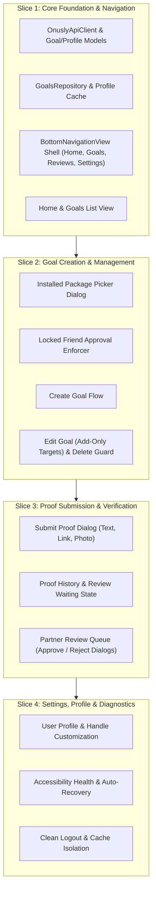

# ONUSLY — Android Implementation Plan: Phase 2 Feature Parity

**Author**: Senior Android & Backend Engineer
**Milestone**: Phase 2 Android Expansion
**Baseline**: Merge commit `a3ba857`
**Target Platform**: Android (Kotlin, Material 3, OkHttp, Coroutines, AccessibilityService)

---

## 1. Executive Summary & Core Invariants

The goal of this phase is to elevate the ONUSLY Android app from an enforcement daemon with a basic sync card into a full-featured client matching the accountability core of the web dashboard (`frontend/`), while strictly preserving the integrity and performance of the background enforcement engine.

### Non-Negotiable Invariants
1. **Zero Degradation of Enforcement**:
   - `OnuslyAccessibilityService` evaluates foreground windows against `SharedPreferencesBlocklistCache` in `<1ms`.
   - Never add network calls, file I/O, or heavy allocations to `onAccessibilityEvent`.
   - Keep `canRetrieveWindowContent="false"` in `accessibility_service_config.xml` (absolute privacy invariant, no screen scraping).
   - System settings (`com.android.settings`), System UI (`com.android.systemui`), default launchers, and phone dialers remain hardcoded in `BlockerEngine.isSystemOrLauncher()`.
2. **Backend API Contract Alignment**:
   - Strictly consume existing backend endpoints (`/goals`, `/enforcement`, `/proofs`, `/approval`, `/users`, `/auth`). No bespoke backend routes.
   - Respect backend state invariants:
     - Targeted goals require `approvalType: "friend"` and valid `approverEmail` or `@handle` (`400 accountability_required`).
     - Distraction targets on active goals are **add-only** (`409 targets_locked` on removal; `409 goal_locked` on deleting active targeted goals).
     - Single approver per goal; self-approval is forbidden (`403`).
3. **Chat Scope Boundary**:
   - 1-on-1 and Community chat are **explicitly out of scope** until backend chat keying is migrated to canonical `USER#<subID>`.
4. **Instant Cache Sync**:
   - Any goal mutation (create, edit, proof submission, approval/rejection) triggers an immediate `SyncRepository.syncBlocklist()` to keep local blocking up to date.

---

## 2. Vertical Slice Breakdown

---

### Slice 1: Core API Client, Models, Navigation Shell & Goal Listing

#### Objectives:
- Expand networking beyond `EnforcementApiClient` to create `OnuslyApiClient`, supporting:
  - `GET /goals`, `GET /goals/{id}`, `POST /goals`, `PATCH /goals/{id}`, `DELETE /goals/{id}`
  - `POST /goals/{id}/proofs`, `GET /goals/{id}/proofs`
  - `POST /goals/{id}/proofs/{proofId}/approval`
  - `GET /users/me`, `PATCH /users/handle`, `GET /users/search?handle={handle}`
- Create structured Kotlin models (`Goal`, `CreateGoalRequest`, `UpdateGoalRequest`, `Proof`, `ApprovalDecision`, `UserProfile`).
- Create `GoalsRepository` orchestrating network fetches, error mapping, and cache sync.
- Transform `MainActivity` into a host with `BottomNavigationView` managing four tabs:
  1. **Home**: Active summary, quick sync, accessibility service status card with one-tap action.
  2. **Goals**: Filterable list (Active, Waiting Review, Completed), empty states, and target badges.
  3. **Reviews**: Incoming approvals pending reviewer decision.
  4. **Settings**: User profile, handle editor, backend base URL, and sign out.
- Unit testing with MockWebServer for API calls and JSON deserialization.

---

### Slice 2: Goal Creation & Editing (Package Picker & Add-Only Rules)

#### Objectives:
- Implement `InstalledAppsManager` to query installed non-system applications using `PackageManager.getInstalledApplications()`, extracting app icon, label, and package name.
- Build `InstalledAppsPickerDialog` allowing users to search and multi-select apps to block.
- Build `CreateGoalBottomSheetDialog` / `CreateGoalActivity`:
  - Input: Title, Description.
  - Distraction Targets: Package picker chips + Domain input chips.
  - Approval Enforcement: Automatically lock approval type to `"friend"` whenever targets are added. Show error if `approverEmail` / handle is missing.
- Implement goal editing with add-only target enforcement:
  - Existing targets displayed as locked chips.
  - New targets can be added.
  - Deleting active goals with targets warns the user and handles `409 goal_locked`.
- Automatic blocklist cache synchronization upon successful mutation.

---

### Slice 3: Proof Submission & Approver Review Loop

#### Objectives:
- Build `SubmitProofBottomSheetDialog`:
  - Proof type selector: `text` (explanation), `link` (URL), `photo` (image URL).
  - Validates required fields before sending `POST /goals/{id}/proofs`.
  - Automatically transitions goal to `proof_submitted` ("Waiting for Review") and syncs blocklist (retaining locks).
- Build `ProofHistoryDialog` to inspect submitted proofs for a goal.
- Implement **Reviews Tab**:
  - Filter user's assigned review goals or review-pending goals.
  - Evidence viewer displaying proof details (text, link preview, photo).
  - Decision buttons: **Approve** (marks completed, unlocks apps) and **Reject** (returns to active, preserves locks).
  - Send `POST /goals/{id}/proofs/{proofId}/approval` with `ownerId`, `status: "approved"|"rejected"`, and optional comment.
  - Trigger immediate blocklist sync on decision.

---

### Slice 4: Settings, Profile, Accessibility Diagnostics & Polish

#### Objectives:
- Implement **Settings Tab**:
  - Display user info (`name`, `email`, `@handle`, `id`).
  - Handle updating via `PATCH /users/handle` with collision detection (`400 handle already taken`).
  - API Base URL configuration (emulator `10.0.2.2:8080` vs custom IP for physical devices).
  - Service status card with deep-link to Accessibility Settings (`Settings.ACTION_ACCESSIBILITY_SETTINGS`).
  - Clear logout flow: clears auth tokens, clears blocklist cache, resets UI to signed-out state.
- Offline resilience: Graceful fallback when API is unreachable, showing cached goals and offline banner.
- Final test verification and regression pass.

---

## 3. Verification Protocol

Each vertical slice must pass:
1. **Static Analysis & Compilation**:
   - Zero Kotlin compiler errors or warnings.
   - Java 21 compatibility (`sourceCompatibility = JavaVersion.VERSION_17`, `targetCompatibility = JavaVersion.VERSION_17`).
2. **Automated Unit Tests**:
   - Unit tests covering JSON parsing, API request construction, error handling, and model mappings.
   - Cache isolation and repository synchronization tests.
3. **Execution**:
   - `./gradlew testDebugUnitTest` must pass 100%.
   - `./gradlew assembleDebug` produces a valid APK.
