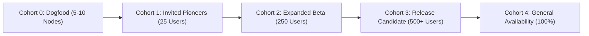

# ONUSLY Operational Plan: Controlled Beta Rollout & Staged Deployment Strategy

**Document ID:** ONUSLY-PL-D15-03  
**Target Audience:** Release Managers, SREs, Product Operations  
**Applicability:** ONUSLY v1.0.0-rc1 Controlled Beta Launch  
**Safety Invariant:** Monitored staged progression. Every stage requires explicit health gates and automated rollback triggers before expanding to subsequent cohorts.

---

## 1. Rollout Cohort Architecture



| Cohort | Target Fleet | Soak Time | Scope & Characteristics | Health Gate |
|---|---|---|---|---|
| **Cohort 0: Internal Dogfood** | 5–10 dev/internal devices | 48 hours | Windows 10/11, Ubuntu 22/24, Android 13-15. Live telemetry check. | 100% heartbeat delivery, zero crashes |
| **Cohort 1: Invited Pioneers** | 25 paired users (50 devices) | 7 days | Trusted accountability pairs testing goal proof submissions & approvals. | $< 1\%$ false lapse rate, zero app hangs |
| **Cohort 2: Expanded Beta** | 100–250 users (200-500 devices) | 14 days | Cross-region, varied ISP/cellular DNS setups, heavy multi-device users. | P99 API latency $< 250$ms, zero rollback errors |
| **Cohort 3: Release Candidate** | 500+ users | 7 days | Final candidate validation under sustained real-world accountability load. | Fleet SLO satisfaction $\ge 99.5\%$ |
| **Cohort 4: General Availability** | All users | Ongoing | Full public release via official signed installers and stores. | Sustained operational SLO compliance |

---

## 2. Automated Health Signals & Prometheus Triggers

The rollout control plane continuously samples metrics exposed by `GET /metrics`:

### 2.1 Fleet Error Budget & Thresholds

| Metric | Normal Range | Warning Threshold (Pause Rollout) | Critical Threshold (Automated Rollback) |
|---|---|---|---|
| **API 5xx Rate** (`onusly_http_requests_total{status=~"5.."}`) | $< 0.05\%$ | $\ge 0.5\%$ | $\ge 1.0\%$ over 5 min |
| **Fleet Lapse Rate** (`onusly_enforcement_lapses_total`) | $< 0.1\%$ | $\ge 1.0\%$ | $\ge 2.5\%$ over 15 min |
| **DNS Resolution Failure** (`onusly_dns_queries_failed_total`) | $< 0.01\%$ | $\ge 0.1\%$ | $\ge 0.5\%$ over 5 min |
| **App Enforcement Degradation** (`onusly_app_enforce_errors_total`) | 0 | $\ge 5$ events/hr | $\ge 20$ events/hr |
| **Database Transaction Conflicts** (`onusly_dynamodb_conflicts_total`) | $< 0.1\%$ | $\ge 1.0\%$ | $\ge 3.0\%$ over 10 min |

---

## 3. Rollout Controls & Action Runbooks

### 3.1 Pause Criteria
If any **Warning Threshold** is breached:
1. Halt progression to the next cohort.
2. Invalidate current release manifest channel in staging/CDN:
   ```bash
   # Switch update channel to 'maintenance' or pin to previous version
   export UPDATE_CHANNEL_ENABLED=false
   ```
3. Convene emergency triage with Platform Lead and SRE.

### 3.2 Rollback Trigger Procedure
If any **Critical Threshold** is breached or severe defect is detected:
1. **Trigger Client-Side Atomic Rollback:**
   Issue an emergency update manifest signed with higher security version pointing to known-stable fallback binary (as verified in D9 rollback protocol).
2. **Backend Rollback:**
   If backend regression caused failure, trigger container rollback to previous task definition:
   ```bash
   aws ecs update-service --cluster onusly-staging --service onusly-backend --task-definition onusly-backend:PREVIOUS_REVISION
   ```
3. **Database Safeguard:**
   Restore isolated snapshot using `DATABASE_BACKUP_AND_RESTORE.md` runbook if schema corruption occurred.
4. **Broadcast Notification:**
   Post operational advisory to beta channel and notify affected users via WebSocket alert.

---

## 4. Post-Rollout Debrief & Retrospective

Within 48 hours of any cohort halt or rollback:
1. Collect all privacy-safe support bundles from affected devices (`onusly-agent support bundle`).
2. Triage logs with secret-sanitization invariants intact.
3. Publish internal Post-Incident Review (PIR) before resuming deployment.

