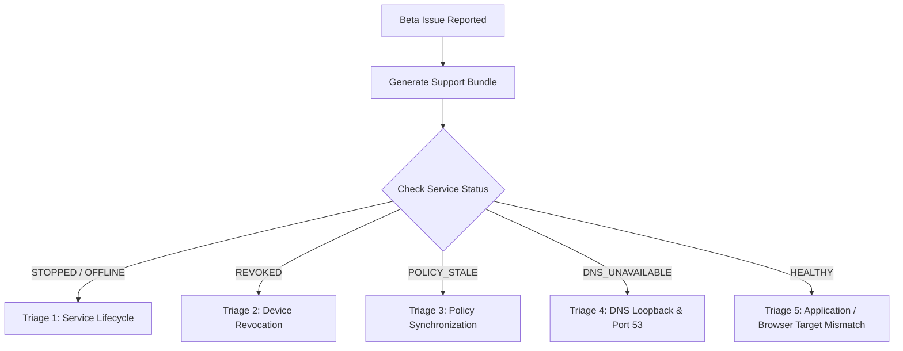

# ONUSLY Operational Guide: Beta Support & Troubleshooting Manual

**Document ID:** ONUSLY-GD-D15-02  
**Target Audience:** Beta Testers, Customer Support Engineers, Tier-1/Tier-2 SREs  
**Applicability:** ONUSLY v1.0.0-rc1 Controlled Beta (Windows, Linux, Android)  
**Privacy Contract:** Zero-Knowledge Support Policy. Support engineers MUST NEVER request full browsing histories, private tokens, passwords, or raw personal files.

---

## 1. Beta Support Philosophy & Privacy Invariants

ONUSLY is built on an unconditional accountability and privacy contract:
1. **No Surveillance:** The application agent blocks predetermined distraction targets without logging general web activity.
2. **Sanitized Diagnostics:** Support bundles capture structural operational health metrics (service uptime, DNS packet counts, policy version) while stripping all personal data, authentication tokens, and user credentials.
3. **User-Consented Export:** The `onusly-agent support bundle` tool requires explicit user consent before inspecting or exporting local diagnostic files.

---

## 2. Generating the Privacy-Safe Support Bundle

When an issue occurs during the beta, users or support personnel can generate a standardized diagnostic report:

### Interactive Mode (Standard User Experience)
```cmd
onusly-agent support bundle
```
The CLI will display the privacy guarantee and prompt:
```
=======================================================
   ONUSLY Privacy-Safe Support Bundle Generation       
=======================================================
This utility collects anonymized, privacy-safe system
and operational health telemetry to assist troubleshooting.

Privacy Invariant:
  - NO personal files, directory contents, or browsing history
  - NO authentication tokens, JWTs, or passwords
-------------------------------------------------------
Do you consent to generate this support bundle? [y/N]: y

✅ Privacy-safe support bundle generated successfully!
File:        onusly-support-bundle.json (783 bytes)
SHA-256:     e86d682a01ee69ac148752efc4cc36b21d02e3b4a094f815001426e9ab86d44a
You can attach this file when filing a beta support ticket.
```

### Unattended / Automation Mode
```cmd
onusly-agent support bundle --yes --output "C:\temp\support-bundle.json"
```

---

## 3. Support Triage Decision Tree



---

## 4. Common Troubleshooting Scenarios & Remediation

### Scenario 1: Live Service Offline / Stopped
- **Symptom:** CLI reports `Service Status: STOPPED / UNREACHABLE`.
- **Diagnosis:**
  - **Windows:** Check SCM service state:
    ```powershell
    Get-Service OnuslyDesktopAgent
    ```
    If stopped, inspect Windows Application Event Log:
    ```powershell
    Get-WinEvent -ProviderName "OnuslyDesktopAgent" -MaxEvents 10
    ```
  - **Linux:** Check systemd unit:
    ```bash
    systemctl status onusly-agent
    journalctl -u onusly-agent -n 20 --no-pager
    ```
- **Remediation:** Start service via administrative prompt:
  - Windows: `Start-Service OnuslyDesktopAgent`
  - Linux: `sudo systemctl start onusly-agent`

### Scenario 2: Device Revoked by Account Owner
- **Symptom:** Agent output shows `Status: REVOKED (Device revoked by account owner)`.
- **Diagnosis:** The device ID was revoked via dashboard or API. Local credentials have been wiped from DPAPI / keyrings.
- **Remediation:** Re-pair the device securely:
  ```powershell
  onusly-agent pair
  ```
  Enter the new 6-character code into the ONUSLY Dashboard under **Connected Devices**.

### Scenario 3: Stale Policy / Network Outage
- **Symptom:** Health state shows `POLICY_STALE`, but DNS/App blocking continues.
- **Diagnosis:** The desktop client cannot reach the backend API, but its Last Known Good (LKG) cache is active.
- **Remediation:**
  1. Test connectivity: `curl -I https://app.onusly.com/health` (or local staging API).
  2. Verify firewall rules allow outbound HTTPS on port 443.
  3. The agent will automatically recover and synchronize once network returns.

### Scenario 4: DNS Resolver Port 53 Conflict
- **Symptom:** `DNS Resolver: DEGRADED / UNHEALTHY (bind: address already in use)`.
- **Diagnosis:** Another local DNS server (e.g., Acrylic DNS, Technitium, Docker, or Windows ICS) is bound to `127.0.0.1:53`.
- **Remediation:**
  1. Identify competing process:
     ```powershell
     Get-NetTCPConnection -LocalPort 53
     Get-NetUDPEndpoint -LocalPort 53
     ```
  2. Stop or reconfigure competing service, then restart ONUSLY agent.

### Scenario 5: Browser Native Messaging Unconnected
- **Symptom:** Extension reports native host not connected; browser targets not enforced.
- **Diagnosis:** Native host registry manifest missing or pointing to invalid binary path.
- **Remediation:** Re-register native host:
  ```powershell
  & "$env:ProgramFiles\Onusly\onusly-native-host.exe" -install
  ```

---

## 5. Escalation & Bug Report Format

If self-service remediation does not resolve the issue, submit a ticket with:
1. **Support Bundle:** Attach `onusly-support-bundle.json`.
2. **Issue Description:** Specific behavior observed vs expected.
3. **Environment:** OS version (e.g. Windows 11 23H2, Ubuntu 24.04 LTS), browser version.
4. **Steps to Reproduce:** Exact sequence leading to the defect.

