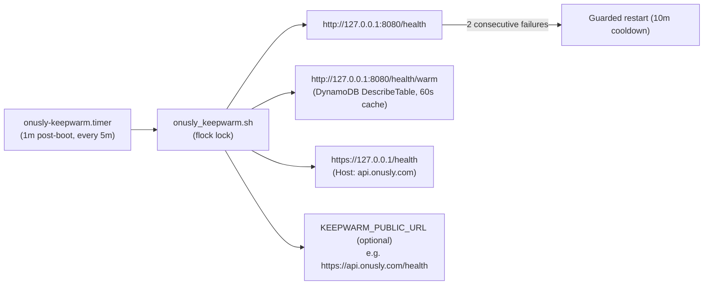

# ONUSLY Operational Runbook: EC2 Deployment & 5-Minute Keep-Warm Cronjob

- **Document ID:** ONUSLY-RB-DEPLOY-01
- **Target Environment:** AWS EC2 (Amazon Linux 2023, `eu-north-1` Stockholm)
- **Traffic Path:** Client → Cloudflare (Full Strict TLS) → EC2 Nginx (`:443`) → Go Backend (`127.0.0.1:8080`) → AWS DynamoDB (`Onusly`)

---

## 1. Overview & Cold-Start Prevention Design

ONUSLY runs as a persistent `systemd` service (`onusly.service`) rather than a serverless function, so the Go process itself does not scale to zero. However, first-request latency spikes and silent downtime can still occur from:

1. **Lazy AWS SDK / DynamoDB Initialization**: `shared.NewDynamoClient()` only loads configuration; TCP/TLS connection setup to DynamoDB and EC2 IMDSv2 IAM credential fetching would otherwise wait for the first live user request.
2. **Idle Connection / TLS Session Teardown**: Cloudflare-to-Nginx, Nginx-to-Go keepalive pools, and SSL session caches cool down during quiet periods.
3. **Memory Page-Out / OOM Pressure**: On smaller EC2 instances, idle memory pages can be swapped or targeted under memory pressure.
4. **Silent Process Hangs**: If the HTTP listener stalls while the PID stays alive, `systemd`'s `Restart=always` will not fire without an active HTTP probe.

### Multi-Layer Cold-Start Elimination

| Layer | Mechanism | File |
|---|---|---|
| **Go Startup** | Non-blocking `DescribeTable` warmup immediately on boot | [cmd/server/main.go](file:///home/devansh/onusly/cmd/server/main.go) |
| **Loopback Warmup API** | `GET /health/warm` (loopback-only, 60s cached `DescribeTable`, 2s timeout) | [cmd/server/main.go](file:///home/devansh/onusly/cmd/server/main.go) |
| **Nginx Boundary** | Blocks `/health/warm` externally (`allow 127.0.0.1; allow ::1; deny all;`) | [deploy/nginx/onusly.conf](file:///home/devansh/onusly/deploy/nginx/onusly.conf) |
| **Process Residency** | `OOMScoreAdjust=-200` on `onusly.service` | [deploy/systemd/onusly.service](file:///home/devansh/onusly/deploy/systemd/onusly.service) |
| **5-Min Scheduler** | `systemd` timer (`OnBootSec=1min`, `OnUnitActiveSec=5min`) | [deploy/systemd/onusly-keepwarm.timer](file:///home/devansh/onusly/deploy/systemd/onusly-keepwarm.timer) |
| **Probe & Recovery** | Checks `onusly`, `/health`, `/health/warm`, `nginx`, TLS, optional public edge | [deploy/cron/onusly_keepwarm.sh](file:///home/devansh/onusly/deploy/cron/onusly_keepwarm.sh) |
| **Log Retention** | Daily rotation, 14 compressed archives | [deploy/logrotate/onusly-keepwarm](file:///home/devansh/onusly/deploy/logrotate/onusly-keepwarm) |



---

## 2. EC2 Prerequisites (First-Time Provisioning)

1. **Launch EC2 Instance**:
   - **OS**: Amazon Linux 2023 (`x86_64` or `arm64`)
   - **Region**: `eu-north-1` (Stockholm), matching the canonical `Onusly` DynamoDB table
   - **IAM Instance Profile**: Attach `onusly-ec2-backend-role` with the policy in [deploy/aws/ec2_dynamodb_policy.json](file:///home/devansh/onusly/deploy/aws/ec2_dynamodb_policy.json) (includes `dynamodb:DescribeTable` needed for warmup).
   - **Security Group**: Allow inbound `80/tcp` and `443/tcp` (prefer Cloudflare IP ranges in production) and restricted `22/tcp` for SSH. Never expose `8080/tcp` publicly.

2. **Clone Repository to `/opt/onusly`**:
   ```bash
   sudo mkdir -p /opt/onusly
   sudo chown -R ec2-user:ec2-user /opt/onusly
   git clone <REPO_URL> /opt/onusly
   ```

3. **Install Cloudflare Origin CA Certificate**:
   - In Cloudflare Dashboard → **SSL/TLS → Origin Server → Create Certificate** (covering `api.onusly.com`, `onusly.com`, `*.onusly.com`).
   - Save certificate and private key on EC2:
     ```bash
     sudo mkdir -p /etc/ssl/onusly
     # Paste certificate into /etc/ssl/onusly/api.onusly.com.pem
     # Paste private key into /etc/ssl/onusly/api.onusly.com.key
     sudo chmod 644 /etc/ssl/onusly/api.onusly.com.pem
     sudo chmod 600 /etc/ssl/onusly/api.onusly.com.key
     ```
   - For non-production bootstrap testing without a Cloudflare certificate, pass `--dev` to `setup_ec2.sh`.

4. **Configure `/etc/onusly/onusly.env`**:
   - Running `setup_ec2.sh` the first time creates a template at `/etc/onusly/onusly.env` (`chmod 600`, `root:root`). Populate required secrets (never put `AWS_ACCESS_KEY_ID` / `AWS_SECRET_ACCESS_KEY` in this file):
     ```env
     HOST=127.0.0.1
     PORT=8080
     ENV=production
     AWS_REGION=eu-north-1
     DYNAMODB_TABLE=Onusly
     ALLOWED_ORIGINS=https://onusly.com,https://www.onusly.com,https://onusly.app
     FRONTEND_URL=https://onusly.app
     GOOGLE_REDIRECT_URL=https://api.onusly.com/auth/google/callback
     VITE_API_BASE_URL=https://api.onusly.com
     GOOGLE_CLIENT_ID=<your-google-client-id>
     GOOGLE_CLIENT_SECRET=<your-google-client-secret>
     JWT_SECRET=<32+-char-random-secret>
     # Enable after DNS/Cloudflare cutover to keep the public edge path warm too:
     KEEPWARM_PUBLIC_URL=https://api.onusly.com/health
     ```

---

## 3. Deploying & Updating

Run the hardened deployment script from `/opt/onusly`:

```bash
cd /opt/onusly
git pull --ff-only
sudo ./deploy/setup_ec2.sh
# Or pin to a specific reviewed commit:
sudo ./deploy/setup_ec2.sh --commit <GIT_SHA>
```

`setup_ec2.sh` automatically:
1. Validates OS (`amzn 2023`), region (`eu-north-1`), IAM instance profile, disk/memory, env secrets, and TLS cert/key cryptographic match.
2. Builds the Go binary atomically (`server.new` → `server` with timestamped backup) and builds `frontend/dist`.
3. Installs [deploy/nginx/onusly.conf](file:///home/devansh/onusly/deploy/nginx/onusly.conf), validates with `nginx -t`, and restarts Nginx (with rollback on error).
4. Installs [deploy/systemd/onusly.service](file:///home/devansh/onusly/deploy/systemd/onusly.service) and restarts `onusly` (with rollback on error).
5. Installs [deploy/cron/onusly_keepwarm.sh](file:///home/devansh/onusly/deploy/cron/onusly_keepwarm.sh), [deploy/systemd/onusly-keepwarm.service](file:///home/devansh/onusly/deploy/systemd/onusly-keepwarm.service), [deploy/systemd/onusly-keepwarm.timer](file:///home/devansh/onusly/deploy/systemd/onusly-keepwarm.timer), and [deploy/logrotate/onusly-keepwarm](file:///home/devansh/onusly/deploy/logrotate/onusly-keepwarm), enables the 5-minute timer, and runs an immediate warmup pass.
6. Runs local `:8080`, `:443`, and `:80` redirect checks.

After deployment, run the external verification probe:

```bash
./deploy/verify_production.sh https://api.onusly.com
```

---

## 4. 5-Minute Keep-Warm Cronjob Behavior

### Schedule & Concurrency
- **Trigger**: `OnBootSec=1min` (warms immediately after EC2 boot) and `OnUnitActiveSec=5min` (`AccuracySec=5s`, `Persistent=true`).
- **Concurrency lock**: `flock -n` on `/run/onusly-keepwarm.lock` prevents overlapping runs.
- **Zero DynamoDB RCU/WCU cost**: `GET /health/warm` uses `DescribeTable` (control-plane API) and caches the result for **60 seconds** in memory.

### Auto-Recovery & Anti-Thrash Guard
- If `http://127.0.0.1:8080/health` fails, the script retries once after 2 seconds.
- On a second consecutive failure, it restarts `onusly.service` **only if** the previous keep-warm restart was more than `KEEPWARM_COOLDOWN_SECONDS` ago (default `600` seconds / 10 minutes), preventing restart loops during hard misconfigurations.
- The same retry + 10-minute cooldown applies independently to `nginx.service`.

### Optional `cronie` Crontab Alternative
Amazon Linux 2023 does not ship `cronie` by default, so `systemd` timers are the primary mechanism. If you ever prefer traditional `cron`:

```bash
sudo dnf install -y cronie
sudo systemctl enable --now crond
echo "*/5 * * * * root /opt/onusly/deploy/cron/onusly_keepwarm.sh >/dev/null 2>&1" | sudo tee /etc/cron.d/onusly-keepwarm
```
*(If switching to `/etc/cron.d/onusly-keepwarm`, stop and disable `onusly-keepwarm.timer` first so they don't both run.)*

---

## 5. Operations, Monitoring & Troubleshooting

### Inspect Timer & Next Scheduled Run
```bash
systemctl list-timers onusly-keepwarm.timer --all
```

### Trigger Manual Run Immediately
```bash
sudo systemctl start onusly-keepwarm.service
```

### View Logs
```bash
# Live systemd journal
journalctl -u onusly-keepwarm.service -n 50 --no-pager
# Persistent log file (rotated daily via /etc/logrotate.d/onusly-keepwarm)
tail -n 50 /var/log/onusly/keepwarm.log
```

Expected healthy log line:
```text
2026-11-25T05:35:00Z [INFO] keepwarm go_health=200(0.002145s) go_warm=200(0.018432s) nginx_tls=200(0.004910s) public=http=200(0.041200s)
```

### Pause During Manual Maintenance
```bash
sudo systemctl stop onusly-keepwarm.timer
# ... perform maintenance ...
sudo systemctl start onusly-keepwarm.timer
```

### Common Failure Modes
- **`go_warm=503`**: Go is healthy, but DynamoDB `DescribeTable` failed. Check EC2 IAM instance profile (`aws sts get-caller-identity`), `AWS_REGION=eu-north-1`, and `DYNAMODB_TABLE=Onusly` in `/etc/onusly/onusly.env`.
- **`go_warm=403`**: Request did not arrive from loopback (`127.0.0.1`/`::1`) or included a non-loopback `X-Forwarded-For` header.
- **`public=http=521` or `000`**: Cloudflare cannot reach EC2 `:443` (check Security Group, DNS A record, or Cloudflare Full Strict Origin CA cert).
